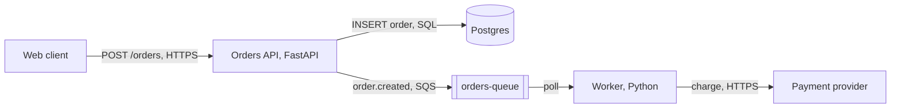
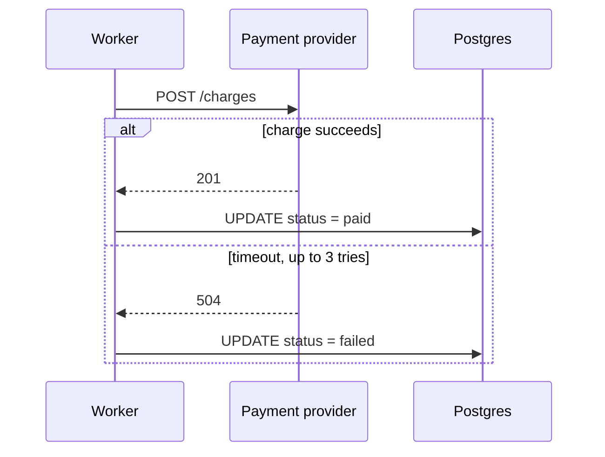

# Diagrams

Draw a diagram when relationships are the point: components and data flow, a sequence across services, a state machine, a deployment topology. Do not draw a diagram of a list. Write diagrams as code so they diff, review, and update with the repo. Default to Mermaid, because GitHub and GitLab render it inline. Use PlantUML, D2, or Structurizr only if the repo already does.

## Choose the diagram

| Question the reader has | Diagram | Mermaid type |
|---|---|---|
| What is this system and what does it talk to? | C4 system context | `flowchart LR` |
| What runs, and how do the parts communicate? | C4 container | `flowchart LR` with `subgraph` |
| What happens, in order, for this request? | Sequence | `sequenceDiagram` |
| What states can this entity be in? | State | `stateDiagram-v2` |
| How is the data related? | Entity relationship | `erDiagram` |
| Where does it run? | Deployment | `flowchart TB` with `subgraph` per environment |

The C4 model's authors say context and container diagrams are enough for most teams. Add component diagrams only where a reader needs them, and skip code-level diagrams, since the code and an IDE show that. Mermaid's native C4 syntax is marked experimental, so use a flowchart and follow C4's notation.

## Rules

- Evidence first. Take boxes from config, IaC, or imports, and arrows from real calls. A diagram is a set of claims, so an arrow without a caller is a fabrication.
- One question per diagram. Split it before you shrink the text.
- Give it a title naming its type and scope, and a key if shape or color carries meaning.
- Use real names. State each element's type and technology ("Orders API, FastAPI") and a short responsibility.
- Make each arrow one-way, with a label saying what flows and over what protocol. "Uses" says nothing.
- Do not rely on color alone. Check it works in greyscale.
- Date or version a diagram that can drift, and check it against the code when the doc changes.

## Accessibility

Every diagram gets `accTitle` and `accDescr`, placed right after the declaration line. Mermaid writes them into the SVG, and this skill's pandoc filter uses them as alt text in Word and PDF. Put the same facts in prose next to the diagram when a reader must act on them.

````markdown

````

Sequence diagrams carry failure paths well, which is what readers usually lack:

````markdown

````

## Syntax that breaks

- Quote labels that contain parentheses, brackets, or punctuation: `api["Orders API (v2)"]`.
- The word `end` in lowercase breaks flowcharts and sequence diagrams. Quote it or capitalize it.
- Unknown words and misspellings break a diagram, while bad parameters fail silently.
- Comments use `%%` on their own line. Avoid `{}` inside them, since they look like directives.
- `accTitle` is one line. A multi-line description uses `accDescr { ... }` with no colon.

If `mmdc` is installed, render to catch errors: `mmdc --input diagram.mmd --output /tmp/out.png`. Otherwise, say that the diagram was not rendered.
